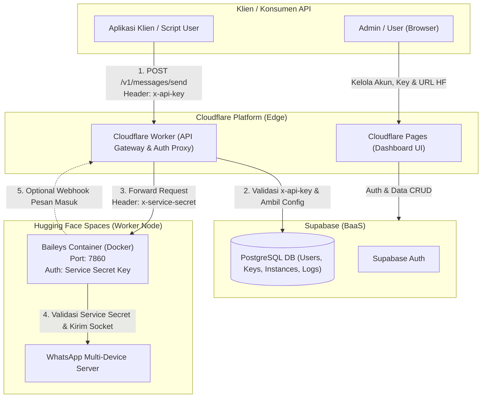

# 🏗️ Rekomendasi Arsitektur WhatsApp Gateway Multi-Tenant
> **Tech Stack:** Cloudflare Pages/Worker (Gateway & Dashboard) + Supabase (Database & Auth) + Hugging Face Spaces (Baileys Engine)

---

## 1. Ringkasan Eksekutif & Jawaban Pertanyaan

> **Apakah arsitektur ini bisa digabungkan?**  
> **YA, SANGAT BISA.** Pola ini merupakan arsitektur standar industri **API Gateway & Microservice Worker Node (Decoupled SaaS Architecture)**.

### Mengapa Pola Ini Sangat Ideal?
1. **Pemisahan Beban (Decoupling):** Cloudflare Worker mengurus routing ultra-cepat, autentikasi API Key, limitasi kuota, dan dashboard UI tanpa membebani runtime WhatsApp.
2. **Koneksi WebSocket Persistent:** Hugging Face Spaces menangani koneksi socket WhatsApp (Baileys) yang memerlukan proses latar belakang non-stop.
3. **Biaya $0 (100% Free Tier):**
   * **Cloudflare:** 100.000 requests/hari gratis (Workers) + unlimited bandwith (Pages).
   * **Supabase:** Free Tier 500 MB PostgreSQL + Built-in Auth + Realtime.
   * **Hugging Face Spaces:** Free Docker Container (2 vCPU, 16 GB RAM).

---

## 2. Diagram Alur Sistem (Architecture Diagram)



---

## 3. Komponen & Pembagian Tugas (Separation of Concerns)

### A. Cloudflare Pages (Frontend Web Dashboard)
* **Teknologi:** React / Vue / SvelteKit / HTML Tailwind.
* **Fitur:**
  * Login/Register pengguna (terintegrasi dengan Supabase Auth).
  * Manajemen API Key (Generate, Revoke, Regenerate Key).
  * Pengaturan Instance WhatsApp (Input URL Hugging Face Space & Service Secret Key).
  * Tampilan Status Koneksi & Iframe / Web QR Code untuk scan perangkat.
  * Log Pesan & Analitik Pengiriman.

### B. Cloudflare Worker (API Gateway & Security Proxy)
* **Tugas:**
  1. Menerima request dari user (`x-api-key`).
  2. Mencocokkan `x-api-key` ke database Supabase untuk mengetahui:
     * Siapa pemilik key tersebut.
     * Berapa sisa kuota / rate limit-nya.
     * URL Hugging Face instance milik user tersebut.
     * Shared `service_secret` untuk berkomunikasi dengan instance HF tersebut.
  3. Memvalidasi payload pesan.
  4. Meneruskan (*forward*) request ke URL Hugging Face dengan menyertakan header keamanan `x-service-secret`.
  5. Mengembalikan response status ke klien dan mencatat log pengiriman ke Supabase.

### C. Supabase (Database & State Management)
* **Tugas:**
  * Menyimpan data tabel pengguna (`users`), instance URL, secret keys, dan riwayat pesan (`message_logs`).
  * Menyediakan Row-Level Security (RLS) sehingga user hanya bisa melihat API Key dan Instance miliknya sendiri.

### D. Hugging Face Spaces (Baileys Engine Node)
* **Tugas:**
  * Menjalankan container Docker `@whiskeysockets/baileys`.
  * Memvalidasi setiap incoming HTTP request menggunakan middleware:
    `if (req.headers['x-service-secret'] !== process.env.SERVICE_SECRET) return res.status(401)`
  * Menyediakan endpoint internal:
    * `GET /api/status` & `GET /api/qr`
    * `POST /api/send` (Kirim pesan via Baileys)
    * `POST /api/webhook/set` (Meneruskan chat masuk ke Cloudflare Worker)

---

## 4. Skema Database Supabase (PostgreSQL DDL)

Berikut rancangan tabel yang siap dieksekusi di Supabase SQL Editor:

```sql
-- 1. Tabel Profil Pengguna (relasi ke auth.users)
CREATE TABLE public.profiles (
    id UUID PRIMARY KEY REFERENCES auth.users(ON DELETE CASCADE),
    email TEXT NOT NULL,
    full_name TEXT,
    created_at TIMESTAMPTZ DEFAULT NOW()
);

-- 2. Tabel Instance WhatsApp (Hugging Face Worker)
CREATE TABLE public.wa_instances (
    id UUID PRIMARY KEY DEFAULT gen_random_uuid(),
    user_id UUID NOT NULL REFERENCES public.profiles(id) ON DELETE CASCADE,
    name TEXT NOT NULL,
    hf_space_url TEXT NOT NULL,         -- Contoh: https://myuser-baileys-bot.hf.space
    service_secret TEXT NOT NULL,       -- Secret key yang didaftarkan di HF & Gateway
    phone_number TEXT,
    status TEXT DEFAULT 'disconnected', -- disconnected / qr_ready / connected
    created_at TIMESTAMPTZ DEFAULT NOW(),
    updated_at TIMESTAMPTZ DEFAULT NOW()
);

-- 3. Tabel API Keys Klien
CREATE TABLE public.api_keys (
    id UUID PRIMARY KEY DEFAULT gen_random_uuid(),
    user_id UUID NOT NULL REFERENCES public.profiles(id) ON DELETE CASCADE,
    instance_id UUID NOT NULL REFERENCES public.wa_instances(id) ON DELETE CASCADE,
    key_name TEXT NOT NULL,
    api_key TEXT UNIQUE NOT NULL,       -- Hash atau token terenkripsi (misal: wabot_live_xxx)
    rate_limit_per_minute INT DEFAULT 30,
    is_active BOOLEAN DEFAULT TRUE,
    created_at TIMESTAMPTZ DEFAULT NOW()
);

-- 4. Tabel Log Pesan
CREATE TABLE public.message_logs (
    id UUID PRIMARY KEY DEFAULT gen_random_uuid(),
    user_id UUID REFERENCES public.profiles(id),
    instance_id UUID REFERENCES public.wa_instances(id),
    target_number TEXT NOT NULL,
    message_text TEXT NOT NULL,
    status TEXT NOT NULL,               -- queued, sent, failed
    response_payload JSONB,
    created_at TIMESTAMPTZ DEFAULT NOW()
);

-- RLS (Row Level Security) Policies
ALTER TABLE public.profiles ENABLE ROW LEVEL SECURITY;
ALTER TABLE public.wa_instances ENABLE ROW LEVEL SECURITY;
ALTER TABLE public.api_keys ENABLE ROW LEVEL SECURITY;
ALTER TABLE public.message_logs ENABLE ROW LEVEL SECURITY;

CREATE POLICY "Users can only view their own instances"
ON public.wa_instances FOR ALL
USING (auth.uid() = user_id);

CREATE POLICY "Users can only view their own api keys"
ON public.api_keys FOR ALL
USING (auth.uid() = user_id);
```

---

## 5. Alur Keamanan Dua Lapis (Two-Tier Authentication)

Keamanan dibuat berlapis agar Hugging Face Space tidak bisa diakses sembarangan oleh publik:

```
[Klien Luar]
    │
    ▼ (Header: x-api-key: wabot_live_abc123)
[Cloudflare Worker]
    │ 1. Cek x-api-key di Supabase
    │ 2. Dapatkan hf_space_url: https://wabot-node.hf.space
    │ 3. Dapatkan service_secret: super-secret-token-xyz
    ▼ (Header: x-service-secret: super-secret-token-xyz)
[Hugging Face Space Baileys]
    │ 1. Middleware cek: req.headers['x-service-secret'] == env.SERVICE_SECRET
    │ 2. Jika valid -> Kirim WhatsApp via Baileys socket
    ▼
[WhatsApp Server / Penerima]
```

---

## 6. Contoh Implementasi Kode

### A. Middleware Keamanan di Baileys (Hugging Face Node)
Tambahkan pengecekan token rahasia sebelum request diproses:

```typescript
// src/presentation/middlewares/auth.middleware.ts
import { Request, Response, NextFunction } from 'express';

export function serviceSecretGuard(req: Request, res: Response, next: NextFunction) {
  const incomingSecret = req.headers['x-service-secret'];
  const expectedSecret = process.env.SERVICE_SECRET;

  if (!expectedSecret) {
    console.error('SERVICE_SECRET environment variable is not defined!');
    return res.status(500).json({ error: 'Server security misconfiguration' });
  }

  if (!incomingSecret || incomingSecret !== expectedSecret) {
    return res.status(401).json({ error: 'Unauthorized: Invalid or missing service secret' });
  }

  next();
}
```

### B. Handler Pengiriman di Cloudflare Worker (`worker.ts`)
```typescript
import { createClient } from '@supabase/supabase-js';

export default {
  async fetch(request: Request, env: any): Promise<Response> {
    const url = new URL(request.url);

    if (url.pathname === '/v1/messages/send' && request.method === 'POST') {
      const apiKey = request.headers.get('x-api-key');
      if (!apiKey) {
        return new Response(JSON.stringify({ error: 'Header x-api-key is required' }), { status: 401 });
      }

      // Inisialisasi Supabase di Edge
      const supabase = createClient(env.SUPABASE_URL, env.SUPABASE_SERVICE_ROLE_KEY);

      // Cari instance berdasarkan API Key
      const { data: keyRecord, error } = await supabase
        .from('api_keys')
        .select('*, wa_instances(*)')
        .eq('api_key', apiKey)
        .eq('is_active', true)
        .single();

      if (error || !keyRecord || !keyRecord.wa_instances) {
        return new Response(JSON.stringify({ error: 'Invalid or inactive API Key' }), { status: 403 });
      }

      const instance = keyRecord.wa_instances;
      const body = await request.json();

      // Teruskan ke Hugging Face Space dengan Service Secret
      const hfResponse = await fetch(`${instance.hf_space_url}/api/send`, {
        method: 'POST',
        headers: {
          'Content-Type': 'application/json',
          'x-service-secret': instance.service_secret
        },
        body: JSON.stringify(body)
      });

      const result = await hfResponse.json();

      // Catat log pengiriman di Supabase secara asynchronous
      env.ctx?.waitUntil?.(
        supabase.from('message_logs').insert({
          user_id: keyRecord.user_id,
          instance_id: instance.id,
          target_number: body.to,
          message_text: body.text,
          status: hfResponse.ok ? 'sent' : 'failed',
          response_payload: result
        })
      );

      return new Response(JSON.stringify(result), {
        status: hfResponse.status,
        headers: { 'Content-Type': 'application/json' }
      });
    }

    return new Response('Not Found', { status: 404 });
  }
};
```

---

## 7. Tips Optimasi & Catatan Penting

1. **Pencegahan Sleep di Hugging Face Spaces**:
   * Cloudflare Worker dapat menjalankan fitur **Cron Trigger** (Scheduled Worker) setiap 15 menit untuk mem-ping endpoint `/api/status` milik Space pengguna, sehingga Space tetap aktif 24/7 dan tidak tertidur (*spin down*).
2. **Multi-User Scaling**:
   * **Model 1: 1 Space untuk Banyak User (Shared Engine)** &rarr; Cocok untuk hemat resource, 1 nomor WhatsApp dipakai bersama seluruh sistem.
   * **Model 2: 1 Space per User (Dedicated Engine)** &rarr; Setiap user membuat Space gratis mereka sendiri dan menautkan nomor masing-masing. Dashboard Anda hanya bertindak sebagai orkestrator dan gateway.
3. **Penyimpanan Kredensial Baileys**:
   * Untuk menjaga sesi WhatsApp di Hugging Face tidak hilang saat rebuild, gunakan adapter auth Baileys yang terhubung ke PostgreSQL Supabase atau MongoDB Atlas gratis.
